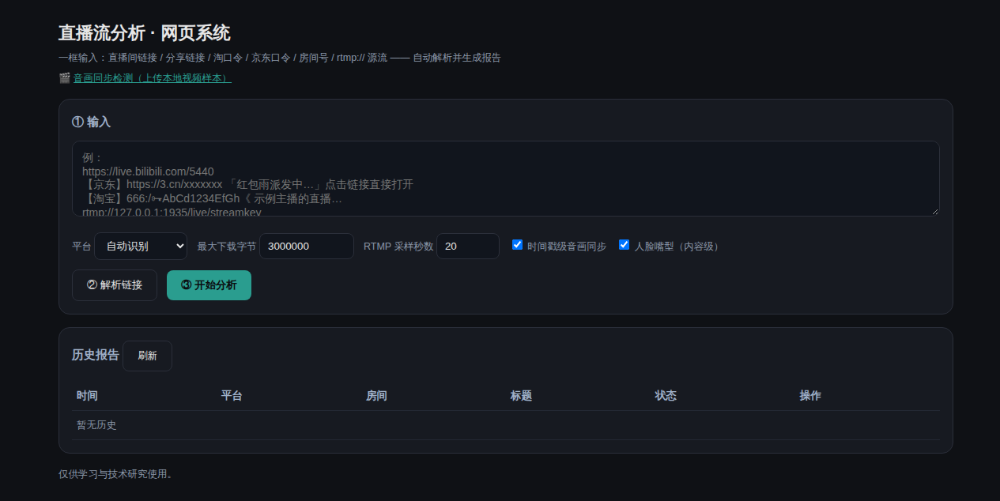
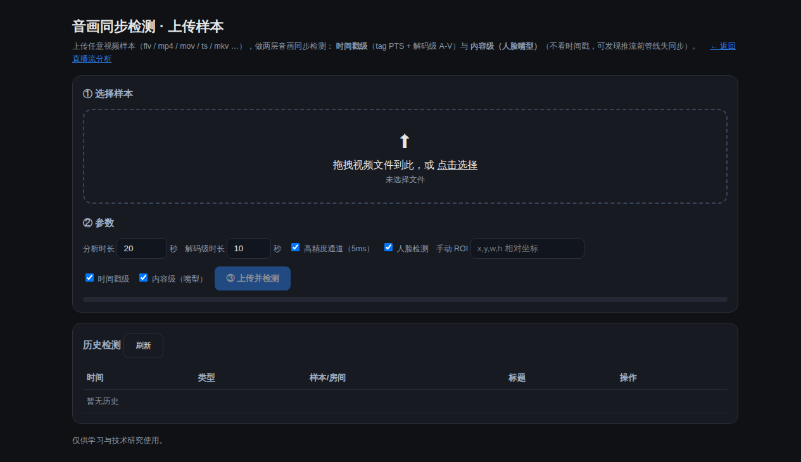

# live-stream-trace

> ⚠️ 使用前请先读仓库根目录的《**合规与免责声明**》：仅供学习、技术研究与自有流排查；
> 不含任何第三方直播内容/真人画面/凭据，不提供任何绕过风控或鉴权的手段。

多平台直播流分析工具（插件化架构）—— 抖音 / 小红书 / 哔哩哔哩 / **淘宝 / 京东 / 通用 RTMP 源流**。

在原「抖音版」「小红书版」两个独立项目基础上重构：**核心（分析/报告/播放器/音画同步）平台无关，
每个平台只需实现一个适配器**（解析直播间 → 返回归一化 `LiveRoom`）。

**仅供学习与技术研究**，请勿用于违反平台条款或法律法规的用途。

## 快速开始

```bash
# 依赖（首次）
python3 -m venv .venv
./.venv/bin/python -m pip install -r requirements.txt
./.venv/bin/python -m playwright install chromium      # 抖音/淘宝/京东适配器需要

# 一键分析（链接 / 房间号均可，自动识别平台）
./run.sh https://live.bilibili.com/5440
./run.sh "https://www.xiaohongshu.com/livestream/dynpathxxx/570493179001095395" --max-bytes 3000000
./run.sh 646454278948 --platform douyin                # 显式指定平台
./run.sh rtmp://127.0.0.1:1935/live/streamkey          # 通用 RTMP 源流
./run.sh "https://tbzb.taobao.com/?roomId=123456789"   # 淘宝直播
./run.sh "https://lives.jd.com/#/123456789"            # 京东直播

./run.sh --list-platforms                              # 查看已接入平台
```

输出：`captures/`（原始证据、FLV 样本、音画同步结果）、`reports/unified_report_<ts>/index.html`。

## 音画同步：两层口径（重要）

| 层 | 模块 | 测什么 | 能发现 | 不能发现 |
|----|------|--------|--------|----------|
| **时间戳级** | `core/av_sync_detector.py` | FLV tag PTS、AAC 帧时长、ffmpeg 解码 A-V | mux/封装/时间戳层面的偏移与漂移 | 已被“烘焙进内容”的失同步（推流器时间戳自洽 → 报 ~0，**漏报**） |
| **内容级（人脸嘴型）** | `core/lip_sync_detector.py` | 嘴部运动能量 × 音频包络互相关，**不看时间戳** | 采集卡/摄像头/声卡等**进 OBS 之前**引入的失同步；观众实际感知的错位 | 需要有人脸特写；无脸/多人/强 BGM 时置信度下降（会明确标注） |

报告会同时给出两者并做**联合诊断**：若“时间戳级≈0 而内容级明显”，即判定为
**推流前管线失同步**（须在采集/前置处理端校正）；反之则是封装/播放器层面问题（多数播放器可自动修正）。

受控实验（`live-stream-trace/.ekko-tmp/tests/verify_lip_vs_ts.py`，容器时间戳对齐、内容注入已知偏移）：

| 注入内容偏移 | 时间戳级 | 解码级(ffmpeg) | 内容级(本工具) |
|---|---|---|---|
| 0 ms | −36 ms | −26 ms | **+6 ms** |
| +300 ms（音频滞后） | −36 ms | −22 ms | **−297 ms** |
| −250 ms（音频超前） | −36 ms | −18 ms | **+257 ms** |

> 结论：时间戳级/解码级把三份样本都判为“几乎同步”（仅残留 AAC encoder priming 的 ~20–36 ms），
> 内容级如实复现注入的 ±250–300 ms 偏移（误差 ≤7 ms，相关峰 r≈0.97）。

关闭嘴型检测：`--no-lip-sync`；调整分析时长：`--lip-sync-seconds 20`。
缺少 `numpy`/`opencv-python-headless` 时自动降级并在报告中提示。

## 架构

```
live-stream-trace/
├── live_trace.py            # 统一 CLI（平台识别 + 通用流水线）
├── core/                    # 平台无关
│   ├── config.py            # 路径 / HTTP / 平台注册 / Cookie 存储
│   ├── flv_analyzer.py      # FLV 流分析 + 推流端指纹
│   ├── av_sync_detector.py  # 音画同步（时间戳级：标签级 + 解码级，毫秒精度）
│   ├── lip_sync_detector.py # 音画同步（内容级：人脸嘴型 × 音频包络，不看时间戳）
│   ├── report.py            # 统一报告（由归一化 payload 驱动，含内嵌播放器）
│   ├── serve.py             # 报告 + 流代理（补 Referer / 按需刷新地址）
│   ├── amf0.py / network.py / mappings_loader.py / capture_manifest.py
│   └── mappings/            # 推流端 / CDN 指纹
├── platforms/               # 平台适配器（每个文件一个平台）
│   ├── base.py              # 接口契约：PlatformAdapter / LiveRoom / StreamTier（含 RTMP 采样钩子）
│   ├── bilibili.py  douyin.py  xiaohongshu.py
│   ├── taobao.py  jd.py     # 可用实现（mtop/接口 + 页面 SSR + Playwright 拦截 XHR）
│   ├── rtmp.py              # 通用 RTMP/RTMPS 源流（H.264 校验 + ffmpeg 录制）
│   ├── _h5_common.py        # H5 抓取通用件（SSR/JSON/流地址提取/浏览器嗅探）
│   ├── _h5_room.py          # 嗅探结果 → 归一化 LiveRoom 的通用装配
│   └── README.md            # 新增平台指引
├── report_assets/           # flv.js + hls.js（随报告分发）
├── cookies/                 # 各平台登录 Cookie（<platform>.cookie，勿提交）
└── run.sh  serve_report.sh  play_source.sh
```

流水线（所有平台共用）：

```
识别平台 → 适配器 resolve() → 档位探活（FLV/HLS/RTMP）
        → 采样（HTTP 下载 / RTMP 由适配器用 ffmpeg 录制）
        → FLV 元数据解析（推流端指纹）
        → 音画同步（时间戳级 + 内容级）→ 归一化 payload → 统一报告
```

## 平台能力对照

| 平台 | 房间解析 | 档位（转码流） | 源流/RTMP | 账号信息 | 开播渠道 |
|------|----------|----------------|-----------|----------|----------|
| 哔哩哔哩 | 公开接口 + 页面 SSR | ✅ qn 档位（原画/蓝光/超清…×FLV/HLS×H.264/H.265） | 无 RTMP（B 站不提供） | ✅ 粉丝/关注/人气/分区 | 由 onMetaData 推断（实测识别 OBS） |
| 小红书 | 页面 SSR（移动端 UA） | ✅ 原画 H.264 / 原画 HEVC / 安卓原画 hcv5400 / 标清（含 HLS） | ✅ RTMP（多主机探测） | ✅ 小红书号/粉丝/关注/获赞（需 Cookie） | ✅ Kasa PC / 手机 App / 第三方 |
| 抖音 | 分享口令/短链 + web/enter（Playwright） | ✅ 蓝光/超清/标清/高清（FLV+HLS） | ✅ 源流（ao 去参构造） | ✅ 昵称/粉丝/关注/在线人数 | ✅ 由 onMetaData 推断 |
| 淘宝直播 | mtop h5 接口 + 页面 SSR + 浏览器拦截 XHR | 取决于接口/页面返回 | 视房间而定（多为阿里云 CDN） | 需登录 Cookie | 平台侧 / 第三方 OBS |
| 京东直播 | **浏览器拦截 XHR（已验证）** + 直连 m 接口 | ✅ 实测拿到 FLV + HLS 双档（`getImmediatePlayToM`） | 视房间而定 | 需登录 Cookie | 平台侧 / 第三方 OBS |
| **RTMP 源流** | URL 即房间（host/app/stream） | —（无转码档位） | ✅ 原生 RTMP/RTMPS | — | FLV `encoder` 标签（OBS/FFmpeg…） |

> 淘宝/京东没有稳定公开接口，三条路线都不保证成功：拿不到流地址时会**降级并写入 notes**
> 说明原因与下一步（配置 `cookies/<platform>.cookie` 等），不会抛异常。

## 通用 RTMP 源流

把推流地址直接交给工具即可（无需平台接口），详见独立项目 `../rtmp-h264-stream-trace/`。

```bash
./run.sh rtmp://127.0.0.1:1935/live/streamkey --capture-seconds 20
```

该适配器会：ffprobe 拉流探测（**校验 H.264**、分辨率/帧率/码率、建连耗时）→
ffmpeg `-c copy` 录制样本（带重试）→ 复用统一流水线的 FLV 解析、推流端指纹、两层音画同步。

## 播放与 CDN

各平台 CDN 策略不同，报告里的「▶ 播放」按钮已统一处理：

- **无本地服务**：直接拉流（小红书/抖音 CDN 支持 CORS，实测可直接播放）
- **有本地服务**（`./serve_report.sh`）：走内置**流代理**
  - 自动补平台 **Referer**（哔哩哔哩 CDN 强制校验 Referer，浏览器无法伪造 → 无代理必 403）
  - 自动补 CORS 头
  - **按需刷新地址**：B 站等 URL 绑定推流会话（约 20~30 分钟失效），代理会实时向适配器要新地址

RTMP 源流浏览器不支持，请用 `./play_source.sh --rtmp`（VLC / ffplay）。

## Cookie 配置

需要登录的字段（如小红书粉丝/关注、淘宝/京东房间信息）从 `cookies/<platform>.cookie` 读取：

```bash
# 浏览器登录后 F12 → Network → 任意请求 → 复制 Cookie 整行
cp /path/to/cookie.txt cookies/taobao.cookie
chmod 600 cookies/taobao.cookie
# 或用环境变量覆盖：LST_COOKIE_TAOBAO="a1=...; web_session=..."
```

## 新增平台

见 [platforms/README.md](platforms/README.md)。核心步骤：

1. 复制 `platforms/taobao.py` 作为模板；
2. 实现 `matches()`（URL/房间号识别）与 `resolve()`（返回 `LiveRoom`：房间信息 + 账号 + 档位 + RTMP + 开播渠道）；
3. 可选覆盖 `refresh_tier()`（地址短时有效时提供实时刷新）、`capture_sample()`（非 HTTP 协议采样，如 RTMP）；
4. 无需改动 core：报告、播放器、音画同步、代理自动生效。

## 已知限制

- 拉流地址随直播会话失效：下播即 404；B 站地址还会在推流会话轮换时提前失效（已由代理刷新解决）。
- 源流可能是 H.265/HEVC：网页 flv.js/hls.js 不支持，报告会提示改用 VLC/ffplay 或选 H.264 档。
- **内容级嘴型检测**依赖人脸可检出：无脸特写/多人/强 BGM 时置信度下降（报告会标注“置信度低”并给出原因）。
- 淘宝/京东适配器依赖登录态与页面结构，平台改版或未登录时会降级（notes 中给出下一步）。
- 部分平台会风控（抖音需 Playwright；小红书偶发需 Cookie）。

## 相关项目

- `../douyin-live-stream-trace/`：抖音独立版（含 RTMP 推流端抓包 `rtmp_capture.py`）
- `../xiaohongshu-live-stream-trace/`：小红书独立版（Cookie / RTMP / 档位）
- `../rtmp-h264-stream-trace/`：通用 RTMP H.264 单流体检

## License

MIT

## 网页系统（一框输入 → 生成报告 → 历史可查）

内置轻量 Web 服务（只用标准库，复用报告静态服务与流代理）：

```bash
./start_web.sh 8899        # 然后浏览器打开 http://localhost:8899/
```



单页流程：

| 步骤 | 说明 |
|------|------|
| ① 输入 | 支持**直播间链接 / 分享链接 / 淘口令 / 京东口令 / 房间号 / `rtmp://` 源流**，一框粘贴即可（自动识别平台，也可手动指定） |
| ② 解析 | `POST /api/resolve`：短链跟随跳转、口令提取、平台与房间号识别；**解析不了会给出明确的手动指引**，不会假装成功 |
| ③ 分析 | `POST /api/analyze`：后台子进程跑 `live_trace.py`，页面轮询实时日志，完成后内嵌展示报告 |
| ④ 历史 | `GET /api/history`：扫描 `reports/` 列出全部历史报告（时间/平台/房间/标题/状态），一键回看 |

接口一览：`GET /`、`POST /api/resolve`、`POST /api/analyze`、`GET /api/jobs`、`GET /api/jobs/<id>`、`GET /api/history`
（任务状态持久化在 `reports/.jobs/`，服务重启后历史不丢）。

### 分享文本/口令解析（`core/share_resolver.py`）

| 输入类型 | 处理 | 实测 |
|----------|------|------|
| 直播间链接 | 直接使用并识别平台/房间号 | ✅ |
| 短链（`3.cn` / `tb.cn` / `jd.hk`…） | 跟随跳转取最终地址 | ✅（京东 `https://3.cn/xxxxxxx` → `lives.jd.com/#/48409854`）|
| 京东口令 | 同上（口令通常自带链接） | ✅ |
| **淘口令** | 提取口令码 → 尝试 mtop 解码 → 失败则给出可执行指引 | ⚠️ 见下 |

> **淘口令为什么只能降级**：淘宝 h5 mtop 网关（`acs.m.taobao.com/h5`）对通用 appKey `12574478`
> 关闭了业务 API 白名单 —— 实测连 `mtop.taobao.media.live.room.info` 都返回
> `FAIL_SYS_API_NOT_FOUNDED`；`tbzb.taobao.com` 页面也只剩 JS 外壳（无 SSR JSON），
> `api.m.taobao.com` 在当前网络不可解析。因此**服务端离线解码淘口令不可行**。
> 工具的做法：提取口令码与主播线索 + 明确提示“在淘宝 App 打开 → 分享 → 复制链接后粘贴回来”，
> 代码保留解码路径（`_try_taobao_password`），配置有权限的 appKey/Cookie 后即可自动生效。

CLI 同样支持分享文本：`./run.sh "【京东】https://3.cn/xxxxxxx …"`

## 京东直播可行性（已实测打通）

结论：**可行**。实测房间 `48409854`（`https://lives.jd.com/#/48409854`）拿到
**FLV + HLS 双档**，`ffprobe` 直接读到 `h264 1080x1920 + aac`，并完成采样、FLV 分析、
时间戳级与内容级音画同步，报告全链路生成。

```bash
./run.sh '【京东】https://3.cn/xxxxxxx 「红包雨派发中，速速来抢【京东相机巨出片】」点击链接直接打开'
./.venv/bin/python tests/verify_jd.py        # 可复现的链路验证
```

### 为什么直连接口不行

| 事实 | 实测 |
|------|------|
| `api.m.jd.com` 可直连 | ✅ 但业务接口返回 **HTTP 403** |
| 真实接口形态 | `appid=h5-live` + **POST** + `functionId=liveDetailToM / getImmediatePlayToM` |
| 风控 | 参数需 `eid` **设备指纹**（由 `js_security_v3_0.1.4.js` 在页面内生成）|
| `lives.jd.com` | hash 路由 SPA，**无 SSR 数据**（9KB 外壳）|
| 拉流 CDN `*.jdcloud.com` | **不需要 Referer/Cookie**（已用 ffprobe 验证）|

→ 可行路线是**无头浏览器**：打开 `#/<liveId>` 让页面自己生成 eid 并调用接口，我们拦截 XHR：
`getImmediatePlayToM` 返回 `{liveId, videoUrl(.flv), h5VideoUrl(.m3u8), pcVideoUrl, status}`，
`status == 1` 即直播中。

### 本轮修掉的问题

1. **`goto` 超时导致整体失败**：hash 路由 SPA 常在 `domcontentloaded` 上超时，
   但页面其实已加载并发出了业务 XHR → `sniff_page` 改为容忍超时并继续抓取，
   同时新增采集 `<video>/<source>` 的 `src` 作为兜底。
2. **推荐位串味**：页面会加载「推荐直播」列表，其流地址属于**其它房间** →
   现在按 `liveId` 精确匹配当前房间的载荷，杜绝把别人的流当成本房间。
3. **`http_probe` 把 206 当失败**：带 `Range` 的探测正常返回 `206 Partial Content`，
   原实现只认 200 → HLS/分片 CDN 被误判不可用（已改为 `200/206` 均通过）。
4. **分享文本未先解析**：文案内嵌短链时会被平台 `matches()` 直接命中，导致整段文案
   被当成 URL 交给适配器 → 改为统一先跑 `share_resolver`，且 `extract_room_id`
   支持**任意位置**的短链展开。
5. **嘴型检测可靠性**：真实直播常见「非说话画面」（产品特写/游戏/贴纸/强 BGM），
   此时互相关很弱、峰值会落在 ±600 ms 搜索边界 —— 原实现仍会输出一个偏移值。
   现在加**可靠性门禁**：`r < 0.15` 或峰值在边界 → 直接判「无法确定（不建议据此判读）」。
   同时人脸检测改为**多级联 × 多参数**（default/alt2/profile），真实流人脸覆盖率 **32% → 100%**。

### 京东侧已知限制

- 房间**标题/主播/粉丝**需要 `liveDetailToM`（实测被风控挡为 403）→ 配置 `cookies/jd.cookie` 登录态后可补齐。
- 拉流地址带会话标识，下播即失效；`refresh_tier()` 会重新走浏览器拦截。
- 每次解析需启动一次无头 Chromium（约 10~20s）。

## 内容级（嘴型）精度细化（2026-10）

### 先把根因说清楚

用户曾反馈“内容级偏移很大（+550ms）”。排查后确认**不是算法数值偏差，而是样本太短**：
默认 `--max-bytes 3MB`，而该间是 1080x1920@**10.5Mbps** → 3MB 只有 **2.4 秒**内容 →
滑窗不足、互相关峰沦为噪声（+550ms 恰好落在搜索边界附近，是随机峰）。

因此做了两层改造：**采够样本** + **把测量精度做上去**。

### 1) 自动补采足够长的样本

`--max-bytes` 只约束 FLV 分析用的样本；嘴型分析会自动按**实测码率**补采一份更长的样本：

```bash
./run.sh <链接> --lip-min-seconds 8 --max-bytes-cap 25165824
# 实测输出：嘴型样本: 补采 lip_sample_....flv（13.1MB, 9.9s；原样本仅 2.4s，码率≈10.5Mbps）
```

### 2) 测量精度：40ms 粒度 → 5ms 网格

| 改动 | 作用 |
|------|------|
| ROI 裁剪后按**源帧率**抽帧（不做倍帧） | 避免 ffmpeg 倍帧复制帧导致的 ±半帧系统偏差（25fps → ±20ms） |
| 运动信号时间取**区间中点** | 消除半帧系统偏差 |
| 信号**线性插值到 5ms 细网格**再做互相关 | 滞后分辨力 40ms → 5ms |
| 音频包络改 **250–3400Hz 语音频带限** | 抑制 BGM/低频轰鸣，提升嘴动↔语音相关性 |
| **滑窗（自适应 1.5–3s）+ 相关性筛选 + 加权中位数 + MAD 置信区间** | 抗噪稳健估计，给出 ±CI 与一致率 |
| 门禁扩展 | 样本过短 / 无脸 / 相关性低 / 峰值在边界 / 滑窗离散过大 / 全局峰与稳健估计矛盾 → 判「**无法确定**」而不是硬给数字 |

### 3) 实测效果

合成精度测试（50fps 平滑运动、**非整数帧**偏移，`tests/precision_lip_sync.py`）：

| 注入 Δ | 期望 | 高精度通道 | 误差 | 分辨力 | CI | 一致率 | r |
|---|---|---|---|---|---|---|---|
| 0 ms | 0 | −3.54 ms | **3.54** | 5 ms | ±0.1 | 100% | 0.918 |
| +137 ms | −137 | −140.57 ms | **3.57** | 5 ms | ±0.05 | 100% | 0.917 |
| −83 ms | +83 | +78.03 ms | **4.97** | 5 ms | ±1.4 | 100% | 0.917 |

真实小红书测试间（`https://xhslink.com/o/6NKArreZnhJ`，17.4s 样本，主播出镜时段）：

| 阶段 | 结果 |
|---|---|
| 改造前 | +550 ms（假峰，等级“高”，与分段时间估计 −404ms 自相矛盾）|
| 改造后 | **+45.9 ms ± 20.1 ms**，滑窗 6/10，一致率 67%，r=0.31，人脸覆盖 100% → 「内容级可感知偏移」 |

同一房间内容会变化：切到**产品特写**时如实判「整窗未检出人脸」；样本不足 4s 判「样本过短」。

### 4) 新增参数

| 参数 | 说明 |
|------|------|
| `--lip-min-seconds` | 嘴型分析最短样本时长（默认 8s，不足自动补采）|
| `--max-bytes-cap` | 补采样本上限（默认 24MB）|
| `--fine-fps` | 互相关细网格帧率（默认 200，即 5ms）|
| `--no-fine` | 关闭高精度通道（回退逐帧，约 40ms）|

报告中新增：**测量分辨力 / 偏移置信区间 / 滑窗一致率 / 样本时长**。

## 音画同步检测入口（上传样本）

除「输入直播间链接」外，网页系统还提供**独立的上传入口**，可直接用本地视频样本做音画同步测试：

```bash
./start_web.sh 8899        # 然后打开 http://localhost:8899/sync
```



| 步骤 | 说明 |
|------|------|
| ① 选择样本 | 拖拽或点击上传，支持 **flv / mp4 / mov / ts / mkv / webm / avi** 等 |
| ② 参数 | 分析时长、解码级时长、高精度通道（5ms）、人脸检测开关、**手动 ROI**（固定机位/无脸时填写 `x,y,w,y` 相对坐标）、可分别开关时间戳级/内容级 |
| ③ 检测 | 后台子进程执行 `core/sync_cli.py`，页面实时日志 + 完成即出结果 |
| 结果 | 时间戳级与内容级卡片（含**分辨力 / 置信区间 / 滑窗一致率 / 人脸覆盖**）+ **互相关曲线图** + 联合诊断 + 样本预览播放器 + 完整报告链接 |

实现要点：

- **非 FLV 自动无损重封装**：`mp4/mov/ts/mkv` 等先 `ffmpeg -c copy` 转 FLV 再做标签级分析；
  编码不兼容时自动降级为「仅解码级 + 内容级」并在报告中注明。
- **标签级只截前 N 秒**：避免把整个大文件读进内存。
- **样本本地预览**：`/uploads/<id>` 支持 **HTTP Range**（可拖动进度条）；FLV 用 flv.js 播放。
- **历史统一**：上传样本报告（`sync_report_*`）与直播流报告（`unified_report_*`）按时间混排，类型列可区分。
- 上传上限 300MB（`MAX_UPLOAD_MB`），样本落在 `uploads/`。

CLI 等价用法：

```bash
./.venv/bin/python core/sync_cli.py --file 样本.mp4 --seconds 20 \
    --roi 0.30,0.55,0.40,0.35 --no-face
```

### 为什么商铺直播会判「无法确定」（实例诊断）

两次抖音商铺直播检测（房间 7696450210096089897，同一场，18:04 与 18:07）内容级都是低置信度，
**原因不是算法没测准，而是这段内容本身不可测**：

| 指标 | 18:04:15 | 18:07:29 | 说明 |
|---|---|---|---|
| 时间戳级 | −6.5 ms | +5.0 ms | 流本身封装正常（不是时间戳问题）|
| 内容级 r | **0.072** | **0.135** | 嘴部运动与音频包络几乎不相关（正常说话特写 ≥0.3）|
| 滑窗一致率 | 11%（9/12 窗）| 0%（7/12 窗）| 每 3 秒估出的滞后在全 ±600ms 区间乱跳 |
| 置信区间 | ±168.7 ms | ±591.4 ms | 离散到无法给结论 |
| 最大脸 粗相关 | 0.075 | 0.152 | 画面**两张脸都试过**，都是噪声级 |
| 次大脸 粗相关 | 0.087 | 0.134 | 说明**音频不是任一可见人脸的说话** |
| 样本时长 | 19.9 s | 19.8 s | 已自动补采，**不是样本过短** |
| 人脸抖动 | 9.6 px | 17.9 px | 主播手持手机做展示 → ROI 内大量非嘴部运动 |

画面实况：商铺带货直播，**主播 + 右下角画中画模特双人脸**，贴纸/榜单遮挡，音频以 BGM/旁白为主。
→ 这类内容用互相关法**本就测不出来**，工具如实判「无法确定（相关性过低）」而不是编一个数字。

**实践建议**：想拿到可信的内容级结果，请在**主播正脸说话**的时段采样；固定机位可用
`--roi x,y,w,h` 直接框住嘴部（跳过人脸检测）；若内容确为 BGM 带货，请以时间戳级结论为准。

### 本轮针对「多人脸 / 人物移动」的鲁棒性升级

| 升级 | 作用 | 实测 |
|---|---|---|
| **多脸候选评分** | 分别用最大脸/次大脸的 ROI 做粗相关，**明显更优（≥0.03）才切换** | 商铺样本两脸 r=0.075/0.087 → 保持最大脸并记录，避免锁定“没说话的那张脸” |
| **双变体运动信号** | `raw`（原始帧差，相位准）与 `aligned`（平移对齐残差，抗人物整体移动）各算一次，择优 | 合成/真人场景 raw 胜出（保住 3~5ms 精度）；对齐变体在测试内容中未胜出但仍保留为兜底 |
| **语音活动诊断** | 输出窗口级语音活跃度（用于识别纯 BGM 内容） | 商铺样本 0.30/0.31（偏低）| 
| 长度对齐修复 | 候选评分处两路信号长度差 1 导致的广播错误 | 已修 |

> 说明：这轮升级没有把商铺直播“救回来”（内容本身不可测），但**保证了好内容不被误伤**
> （小红书 +45.9 ms ± 20.1 ms 的结果保持不变），并让不可测的情形有了可解释的量化依据。

## 抖音分享口令 / 短链（已支持）

抖音分享文案（口令）可以直接整段粘贴，自动解析成直播间链接：

```bash
./run.sh '7- #在抖音，记录美好生活#【示例主播】正在直播… https://v.douyin.com/sh4re1d0002/ $3 CA2078 8@x.com :0pm'
```

实测输出：

```
类型：douyin_share   平台：抖音   房间号：7600000000000000001
· 检测到短链，跟随跳转：https://v.douyin.com/sh4re1d0002/
· 跳转后：https://webcast.amemv.com/douyin/webcast/reflow/7600000000000000001?…
状态：直播中 | 标题：示例直播标题 | 主播：示例主播（UID 1000001）
档位：17 个（源流/备线 × 蓝光·超清·标清·高清 × FLV/HLS）
```

### 解析链路（为什么这样实现）

| 步骤 | 说明 |
|------|------|
| 1. 提取短链 | 文案里可能是 `v.douyin.com/xxx`（已加入 `SHORT_HOSTS`），也可能直接是 `live.douyin.com/<web_rid>` |
| 2. 跟随跳转 | 抖音直播分享实际跳到 **`webcast.amemv.com/douyin/webcast/reflow/<内部 room_id>`**（移动端直播页），**不是** `live.douyin.com` |
| 3. 目标归一 | `douyin._resolve_target()` 把输入归为 `web_rid` / `internal`（reflow 页，含内部 room_id）/ `page`（跳到了主页等）三种 |
| 4. 浏览器打开 | **直接打开跳转后的 reflow 页**（而不是拼 `live.douyin.com/{id}`），让页面自己带签名请求 |
| 5. 拦截响应 | `dy_auth_impl` 现在同时拦截 **`/webcast/room/web/enter/`** 与 **`/webcast/room/reflow/info/`**，兼容两种响应结构 |

> 为什么必须走浏览器：直连接口需要签名（实测 `reflow/info` 返回 `status_code=10011`、
> 用内部 room_id 调 `web/enter` 返回空数据）。浏览器方案由页面自己生成 msToken/a_bogus，最稳。

新增回归测试：

```bash
./.venv/bin/python tests/verify_douyin_share.py        # 分享文案 → 直播间 → 房间/档位
```

> 性能提示：抖音单场有 17 个档位（源流/备线/多清晰度×协议），逐档探活约需 2~4 分钟；
> 想更快可加 `--no-tier-probe`（跳过探活，直接按档位标签取用）。

### 判据演进：为什么“无法确定”的原因会变（含一次假阳性纠正）

**第一步：修判据尺度。** 早期用 3 秒滑窗的中位/离散做判据，但 3 秒只有 2~3 个音节，
单窗峰值会被局部噪声带跑（同一样本 3s 窗滞后从 −275ms 跳到 +253ms），而**更长的分段高度一致**。
故判据改为**多尺度分段**（整段 / 二分 / 三分 / 样本≥18s 时加 6s 滑窗）→ 加权中位数 + MAD；
3s 短窗降级为「局部抖动」诊断指标。

**第二步：反证测试发现假阳性。** 把 ROI 从嘴部移到**完全没有嘴的产品区**，竟然也能得到
`−53.7 ms、一致率 83%、r=0.199` 这种“像样”的结果 —— 说明商铺直播里
**画面整体运动/BGM 耦合**会伪装成嘴型同步。

**第三步（现行判据）：嘴型特异性对照。** 在嘴部 ROI 之外，自动生成 2~3 个**同尺寸对照区域**
（左/右/下/上偏移，避开嘴部），比较粗相关：

> 只有 **嘴部 r ≥ 对照最高 r + 0.08** 才认为测到的是嘴型；
> 否则判「无法确定（嘴型特异性不足）」并给出两组数值。

| 样本 | 嘴部 r | 对照最高 r | 特异性 | 结论 |
|---|---|---|---|---|
| 小红书主播间（长样本）| **0.300** | 0.151 | ✅ 通过 | 内容级可感知偏移 **+45.8 ms ± 19.2**（一致率 75%）|
| 合成受控（手动 ROI，注入 +300ms）| **0.971** | 0.141 | ✅ 通过 | −294.5 ms（误差 ~5ms）|
| 示例主播 104851（自动人脸）| 0.168 | 0.100 | ❌ 裕度仅 0.068 | 无法确定（特异性不足）|
| 示例主播 105203（自动人脸）| 0.170 | 0.182 | ❌ | 无法确定（特异性不足）|
| 同上，换成产品区（无嘴）| 0.164 | 0.168 | ❌ | 无法确定（特异性不足）|
| Dangerouspeople 180415 | 0.075 | 0.095 | ❌ | 无法确定（特异性不足）|

> 结论：**商铺带货直播（BGM/旁白 + 走动 + 遮挡）目前测不出可信的内容级偏移**，
> 工具会如实拒绝而不是给数字；时间戳级仍然可用（这几场都是 ±5~21 ms 的“同步良好”）。
> 想拿到可信数字：等主播**正脸说话**，或用 `--roi` 把 ROI 精确压在嘴部。

同轮修复：`_corr_at` 在两路信号长度不等时切片越界抛异常（被特异性的 `except` 吞掉导致检查偶发失效）。

## 健康片段自动选段（持续捕获 → 小播放器 + 人脸/嘴部截图）

直播样本里只有「主播正脸持续说话」的那几秒才可能测出可信的内容级偏移。
本功能会**持续捕获**一段流，自动挑出这样一段「健康片段」，并在网页上可视化：

> 截图未随仓库分发（含第三方主播画面，已脱敏移除）。运行 `./run.sh <链接>` 生成的报告里可见该区块。

```bash
./run.sh '<链接或分享文案>' --segment-seconds 45 --segment-window 6   # 默认开启，--no-segment-scan 可关
```

### 流程

| 步骤 | 说明 |
|------|------|
| ① 持续捕获 | 按实测码率补采到 `--segment-seconds`（默认 40s） |
| ② 滑窗打分 | **单次抽帧**后滑窗（默认 6s 窗 / 1.5s 步），逐窗计算：人脸覆盖、人脸抖动、嘴部运动、语音活动、嘴部相关性、特异性，再加**邻窗连续性**加权 |
| ③ 选出片段 | 取连续合格窗口的最大区间（实测示例主播：`4.56~15.12s`，最佳分 103.7）|
| ④ 导出可视化 | 片段转成 **H.264 MP4 小播放器**（报告内可直接播）+ 3 个时刻的 **人脸框与嘴部放大截图**（各 3 张）|
| ⑤ 片段测量 | 在片段上按统一口径复测偏移（多尺度 + 特异性对照），给出偏移/CI/一致率/嘴部r vs 对照r |

打分（0~100）：`0.18×人脸覆盖 + 0.12×稳定性 + 0.18×嘴部运动 + 0.18×语音活动 + 0.24×嘴部相关性 + 0.10×特异性`，
再加 0.3×邻窗平均分作为连续性加成。

### 报告中可见的内容

- 「🎯 健康片段（自动选段）」区块：片段区间 / 选段得分（含各分项）/ 片段偏移 / 置信区间 / 一致率 / 分辨率 / 嘴部 r vs 对照 r（特异性）
- **片段回放小播放器**（HTML5 video，可拖动进度）
- **人脸 / 嘴部截图网格**（点击放大；文件名标注时刻）
- 该片段的完整判定说明（与全样本口径一致，含「无法确定」的具体原因）

> 注意：「选出片段」≠「一定能给出可信数字」。若该片段仍然特异性不足（例如带货直播里
> 手/产品就在嘴边、背景面板也在动），工具依然会判「无法确定」——但你现在**能看到那段画面与截图**，
> 从而人工确认原因。

### 同轮修复

1. **FLV 时长读不到 0.0**：直播录制的 FLV 常无 duration 元数据 → 先用 `ffmpeg -i` 的 `Duration:`，
   再用 FLV tag **首尾差**兜底（注意部分流的时间戳是「上行绝对时间」，不能直接用最后值）。
   这修掉了「原样本仅 0.0s」导致反复补采 25MB 的问题。
2. **`--no-tier-probe` 时无法采样**：未探活时按标签优先级回退选档（源流/原画 FLV 优先）。
